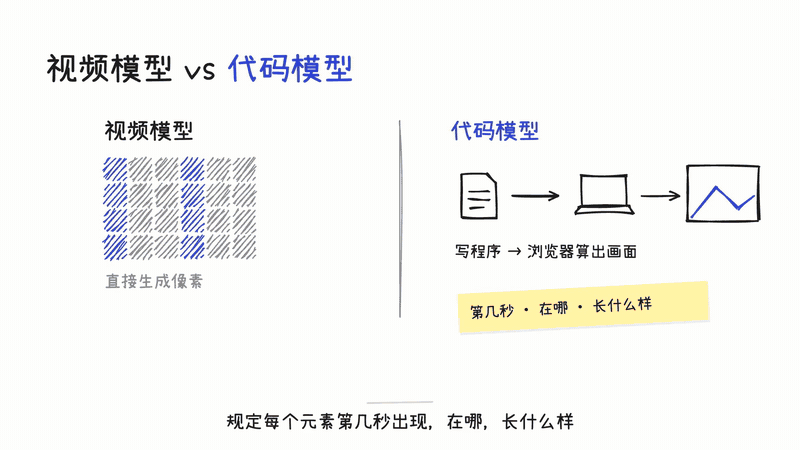

# space-handdrawn-motion-video

白板手绘风格的动效视频 Skill（Claude Code / Agent Skill）。字一个个手写出来，线条像马克笔一笔笔画出来，一支马克笔跟着笔尖走；截图和视频片段用胶带贴在白板上，场与场之间镜头在白板上横移。适合产品介绍、功能讲解、知识科普。

## 演示

[](https://github.com/SpaceZephyr/space-handdrawn-motion-video/releases/download/v0.1.0/demo-codemotion.mp4)

点上面的动图看完整成片（3 分 33 秒，1080p，带配音和配乐）：[demo-codemotion.mp4](https://github.com/SpaceZephyr/space-handdrawn-motion-video/releases/download/v0.1.0/demo-codemotion.mp4)。这条是用本 Skill 把一篇文章做成的讲解视频，稿子和每场画面在 [examples/codemotion](examples/codemotion)。

## 能做什么

| | |
|---|---|
| 字 | 手写字体「小赖」，标题和标注一个字一个字写出来 |
| 线 | rough.js 生成的抖动线稿，加粗圆头，按顺序一笔笔画出 |
| 笔 | 写字、画线时马克笔跟着笔尖走，笔速可调（`pace`） |
| 素材 | 截图 `pin()`、视频片段 `clip()`、局部放大 `lens()`、便利贴、手绘外壳的手机和浏览器 |
| 声音 | 本地 TTS 配音（中文或英文），Whisper 逐字对时，画面按旁白关键词出现；配乐卡拍点，转场 whoosh、弹出 pop、写字的马克笔声 |
| 字幕 | 中文、英文，或中英双语 |
| 比例 | 16:9、3:4、9:16、1:1 |

画面全是 HTML + SVG，由按时间推进的运行时驱动，无头 Chrome 逐帧截图，所以每一帧都能复现，改一句话只重跑那一句。

## 安装

```bash
git clone https://github.com/SpaceZephyr/space-handdrawn-motion-video ~/.claude/skills/space-handdrawn-motion-video
cd ~/.claude/skills/space-handdrawn-motion-video
npm i --prefix scripts                 # puppeteer-core、roughjs
bash scripts/assets/fetch_audio.sh     # 下载配乐和音效（Mixkit）
```

还需要：Chrome、ffmpeg、Python 3（numpy）。配音用 [yovoice](https://github.com/leemysw/yovoice)（Qwen3-TTS CustomVoice，本机运行，不克隆任何人的声音），校验用 mlx-audio + whisper-large-v3-turbo（Apple Silicon）。不配音也能做，只垫配乐。

## 用法

在 Claude Code 里说「用手绘风格介绍 XX」「把这篇文章做成白板动画」就会触发。完整流程见 [SKILL.md](SKILL.md)：

```
素材 → lines.json（一句一场）→ 配音 + 对时 → scenes.mjs（每场画面）→ 逐帧渲染 → 混音 → MP4 + 封面
```

参考：[画面写法和组件](references/scene-patterns.md) · [配音](references/voice.md) · [踩过的坑](references/pitfalls.md)

例子：
- [examples/codemotion](examples/codemotion)：讲解类，文章 → 3 分半视频，每种工具配演示动图和案例片段
- [examples/grokbot](examples/grokbot)：产品介绍，中文旁白，84 秒
- [examples/grokbot-en](examples/grokbot-en)：同一个产品，英文旁白 + 中英双语字幕 + 动感卡点

例子里用到的第三方截图和视频片段不随仓库分发，重做时按各例子 README 里的说明重新抓。

## 授权

代码 MIT。字体 [小赖 Xiaolai](https://github.com/lxgw/kose-font)，SIL OFL 1.1（[assets/fonts/OFL.txt](assets/fonts/OFL.txt)）。配乐和音效来自 [Mixkit](https://mixkit.co/license/)，免费可商用，但不允许再分发原文件，所以由 `fetch_audio.sh` 下载，不放进仓库。演示视频里引用的 YouTube 片段版权归原作者，画面下已标注出处。
